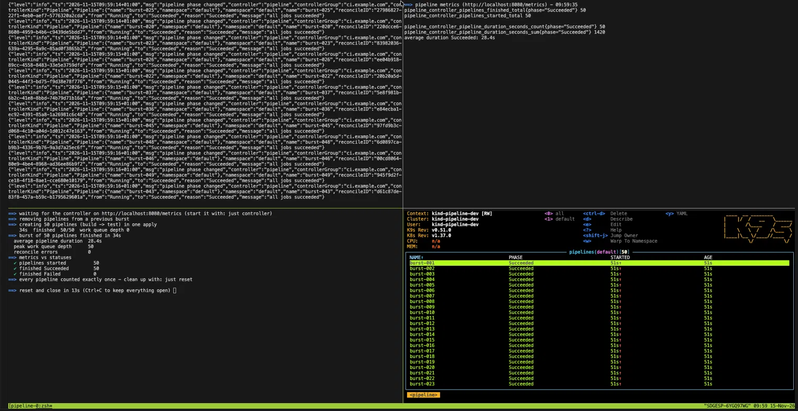

# k8s-pipeline-controller

A Kubernetes controller, built with [kubebuilder](https://book.kubebuilder.io/), that runs CI-style
pipelines. You describe reusable jobs once (`PipelineJobTemplate`), list them in a `Pipeline`, and the
controller runs them one after another as Kubernetes Jobs, stops at the first failure and reports
progress in the Pipeline's status, Prometheus metrics and structured (JSON) logs.

## Quick start (demo)

Requirements: Docker running, and macOS with [Homebrew](https://brew.sh) for the automatic install
(on Linux, install `go`, `kind`, `kubectl`, `just` yourself; `tmux`, `fzf`, `k9s` are optional).

```bash
./demo/setup.sh     # installs missing tools (asks first), creates a kind cluster, installs the CRDs
just demo-live      # one screen: controller log | live metrics | all scenarios | k9s
```

`just demo-live` runs all seven scenarios below at once, prints a summary, checks the metrics against
the pipeline statuses, then cleans up and closes itself after 30 seconds. `just` lists every command.

Step by step, in two terminals:

```bash
just controller                        # terminal 1: run the controller locally (metrics on :8080)
just scenario 04-two-jobs-first-fails  # terminal 2: one scenario (no name: pick one with fzf)
just logs two-jobs-first-fails         # every step's output, in order
just metrics                           # started / finished / duration
just reset                             # delete all pipelines
just cluster-down                      # delete the kind cluster
```

## The two resources

A complete example, ready to apply while the controller runs (`just controller`):

```bash
kubectl apply -f - <<'EOF'
apiVersion: ci.example.com/v1alpha1
kind: PipelineJobTemplate          # a reusable job: an ordered list of steps (containers)
metadata:
  name: compile-and-package
spec:
  steps:
    - name: compile                # steps share /workspace, so the next step sees this file
      image: busybox:1.37
      command: ["sh", "-c", "echo binary > /workspace/app && echo compiled"]
    - name: package
      image: busybox:1.37
      command: ["sh", "-c", "ls /workspace && echo packaged"]
---
apiVersion: ci.example.com/v1alpha1
kind: PipelineJobTemplate
metadata:
  name: ship
spec:
  steps:
    - name: ship
      image: busybox:1.37
      command: ["sh", "-c", "echo shipped"]
---
apiVersion: ci.example.com/v1alpha1
kind: Pipeline                     # an ordered list of jobs, each pointing to a template
metadata:
  name: release
spec:
  jobs:
    - {name: build, templateRef: compile-and-package}
    - {name: deploy, templateRef: ship}
EOF

kubectl get pipeline release -w    # Pending -> Running -> Succeeded
just logs release                  # each step's output, in order
```

```sh
$ kubectl get pipelines
NAME      PHASE       STARTED   AGE
release   Succeeded   40s       40s
```

To write your own, put the same YAML in a file and `kubectl apply -f my-pipeline.yaml`; the templates
in `demo/scenarios/templates.yaml` (`build`, `test`, `deploy`, `broken`) can be reused directly. A
Pipeline's spec can't be changed, so to run it again: `kubectl delete pipeline release` and apply it
again.

## How it runs

- **One Kubernetes Job per pipeline job**, named `<pipeline>-<index>-<job>`, owned by the Pipeline
   (deleting the Pipeline deletes its Jobs and pods).
- **Steps run in order inside one pod**: every step but the last is an init container, the last one is
   the main container. They share an `emptyDir` mounted at `/workspace`, so a step can pass files to
   the next.
- **Jobs run sequentially.** Job *n+1* is created only after job *n* succeeded.
- **Fail fast, no retries** (`backoffLimit: 0`): the first failing job marks the Pipeline `Failed`; the
   jobs after it are reported as `Skipped` and never created.
- **Status**: `status.phase` (`Pending` → `Running` → `Succeeded` / `Failed`), one entry per job in
   `status.jobs` (phase, Job name, start and completion time), the pipeline's start and completion
   time, and a `Ready` condition with a reason and message.
- **Validation in the API** (CRD schema and CEL): at least one job and one step, unique names, at most
   50 jobs, Job names within the 63-character limit, and the Pipeline spec is immutable (re-running
   means creating a new Pipeline).
- **Missing template**: the Pipeline waits (`Ready` reason `TemplateNotFound`) and is re-checked every
   15 seconds, so creating the template later unblocks it.

## Scenarios

`demo/scenarios/templates.yaml` defines four templates: `build`, `test` and `deploy` succeed,
`broken` exits with code 1. Each scenario has an integration test with the same name in
`internal/controller/pipeline_scenarios_test.go`.

| Scenario                     | Jobs                    | Expected                                                  |
| ---------------------------- | ----------------------- | --------------------------------------------------------- |
| `01-one-job-ok`              | build                   | Succeeded                                                 |
| `02-one-job-fail`            | broken                  | Failed                                                    |
| `03-two-jobs-ok`             | build → test            | Succeeded                                                 |
| `04-two-jobs-first-fails`    | broken → deploy         | Failed, deploy Skipped (its Job is never created)         |
| `05-three-jobs-second-fails` | build → broken → deploy | Failed, deploy Skipped                                    |
| `06-three-jobs-ok`           | build → test → deploy   | Succeeded                                                 |
| `07-parallel`                | two pipelines at once   | parallel-a Succeeded, parallel-b Failed in its second job |

## Load check

`just burst [N]` creates N pipelines (build → test) in a single `kubectl apply`, waits until all of
them finish and checks that the metrics count every pipeline exactly once. `just burst-live [N]` runs
it on the same four-pane screen as the demo.



On a laptop (kind, one node):

| Pipelines | Wall time | Avg pipeline duration | Peak work queue depth | Reconcile errors | Counted once |
| --------- | --------- | --------------------- | --------------------- | ---------------- | ------------ |
| 10        | 15 s      | 14.6 s                | 10                    | 0                | yes          |
| 50        | 34 s      | 28.4 s                | 50                    | 0                | yes          |

The work queue peaks at almost every pipeline and drains back to zero: one worker keeps up, because a
reconcile takes milliseconds. The longer pipeline durations at 50 come from 100 pods sharing one kind
node, not from the controller. Under this load the informer cache can lag behind the controller's own
status writes; status patches carry an optimistic lock, so a reconcile working from stale data gets a
conflict and retries instead of counting a transition twice.

## Observability

Metrics on `/metrics` (`just metrics`, or `just metrics-watch` to refresh):

| Metric                                          | Type      | Labels                      |
| ----------------------------------------------- | --------- | --------------------------- |
| `pipeline_controller_pipelines_started_total`   | counter   | none                        |
| `pipeline_controller_pipelines_finished_total`  | counter   | `phase` (Succeeded, Failed) |
| `pipeline_controller_pipeline_duration_seconds` | histogram | `phase`                     |

Labels are kept low-cardinality on purpose (no pipeline names). Logs are JSON, one line per event,
with the pipeline and the reconcile ID attached; each status change is a `pipeline phase changed`
line with `from`, `to`, `reason` and `message` (`just controller-logs`). For human-readable local
output, run the controller with `--zap-devel=true`.

## Tests

| Command         | What it covers                                                                                                                                                                                                                                                | Needs a cluster?             |
| --------------- | ------------------------------------------------------------------------------------------------------------------------------------------------------------------------------------------------------------------------------------------------------------- | ---------------------------- |
| `make test`     | Unit tests (Job building, the decision logic, status, metrics) and integration tests: the seven scenarios above, run against a real API server ([envtest](https://book.kubebuilder.io/reference/envtest)) where the test plays the role of the Job controller | No                           |
| `make lint`     | golangci-lint, the same check as CI                                                                                                                                                                                                                           | No                           |
| `make test-e2e` | Builds the image, deploys the manager to a kind cluster with its generated RBAC, checks the metrics endpoint, then runs two pipelines with real pods (sequencing, fail fast, `Skipped`)                                                                       | Creates its own kind cluster |
| `just demo`     | The scenarios on a real cluster, with real pods, checked against the statuses and the metrics                                                                                                                                                                 | The demo cluster             |
| `just burst`    | 50 pipelines at once; every one finishes and is counted exactly once                                                                                                                                                                                          | The demo cluster             |

GitHub Actions runs `make lint`, `make test`, `make test-e2e` and `govulncheck` on every push and pull
request. Pushing a `v*` tag publishes a release (see Install).

## Repository layout

| Path                      | Contents                                                                                                                                                                                                                         |
| ------------------------- | -------------------------------------------------------------------------------------------------------------------------------------------------------------------------------------------------------------------------------- |
| `api/v1alpha1/`           | The CRD types and their validation markers                                                                                                                                                                                       |
| `internal/controller/`    | The reconciler (`pipeline_controller.go`), split into building Jobs (`job_builder.go`), deciding the next action (`decide.go`), computing status (`status.go`) and recording transitions (`transitions.go`), each with its tests |
| `internal/metrics/`       | The Prometheus metrics                                                                                                                                                                                                           |
| `config/`                 | Generated CRDs, RBAC and the manager deployment (kustomize)                                                                                                                                                                      |
| `demo/`                   | The demo: setup script, scenarios, the scripts behind the `justfile`, and `try-release.sh`                                                                                                                                       |
| `docs/decisions.md`       | The design decisions, the reasons behind them and the known limits                                                                                                                                                               |
| `docs/thought_process.md` | Working notes written while building it                                                                                                                                                                                          |
| `test/e2e/`               | The end-to-end test on kind                                                                                                                                                                                                      |
| `.github/workflows/`      | CI (lint, tests, e2e, govulncheck) and the release workflow                                                                                                                                                                      |

The `Makefile` (kubebuilder's) builds, tests and deploys the operator; the `justfile` only drives the
local demo.

## Install a release

Each release publishes a multi-arch image on `ghcr.io` and a single `install.yaml` with the CRDs, RBAC
and the controller Deployment:

```bash
kubectl apply -f https://github.com/MateusDSouza/k8s-pipeline-controller/releases/latest/download/install.yaml
kubectl get pods -n k8s-pipeline-controller-system      # the controller-manager pod is Running
kubectl apply -f demo/scenarios/templates.yaml -f demo/scenarios/03-two-jobs-ok.yaml
kubectl get pipelines -w
```

To check a release end to end without touching your own cluster:

```bash
VERSION=v0.2.0 ./demo/try-release.sh   # temporary kind cluster -> install the release -> run a pipeline -> delete everything
```

It needs only `docker`, `kind`, `kubectl` and `curl`, keeps the cluster's credentials in a temp
folder (your kubeconfig is not changed) and exits with an error if the pipeline doesn't succeed.
`KEEP=1` keeps the cluster to look around.

Pipelines run in any namespace except ones that enforce the `restricted` Pod Security Standard (see
the known limits). `v0.1.0` is the version submitted for review; later versions are listed under
[Releases](https://github.com/MateusDSouza/k8s-pipeline-controller/releases).

## Design decisions and known limits

Every choice above (why Jobs with init containers, why no retries, why the spec is immutable, why
these metrics) is explained in [docs/decisions.md](docs/decisions.md), together with the known
limits: sequential jobs only, no security context on step containers, a single reconcile worker, and
releases that rebuild the image on the tag.

## How it was built

The project was built in small steps, each one a pull request: the scaffold, the API types, the
reconciler, observability, the integration tests, the demo and these docs. The
[closed pull requests](https://github.com/MateusDSouza/k8s-pipeline-controller/pulls?q=is%3Apr+is%3Aclosed)
and the [commit history](https://github.com/MateusDSouza/k8s-pipeline-controller/commits/main) show
that order. [docs/thought_process.md](docs/thought_process.md) holds the working notes from the same
time, kept as they were written: how each part was understood before it was implemented, the errors
found along the way and how they were fixed.

## Troubleshooting

| Problem                                                         | Fix                                                                                                                          |
| --------------------------------------------------------------- | ---------------------------------------------------------------------------------------------------------------------------- |
| `Docker is not running`                                         | Start Docker Desktop (or `colima start`) and re-run                                                                          |
| Port 8080 or 8081 already in use                                | Another controller is still running: stop it (Ctrl+C); `just demo-live` stops an old one itself                              |
| `Unsupported value` or unknown fields when applying             | The CRDs in the cluster are outdated: `just cluster-up` reinstalls them                                                      |
| A pipeline stays `Pending`                                      | Its template is missing (`kubectl get pjt`), or the controller isn't running                                                 |
| `make lint` fails locally with `export data version`            | Your Go is newer than the linter supports: `GOTOOLCHAIN=go$(go mod edit -json \| jq -r .Go) make lint`                       |
| Controller pod in `ImagePullBackOff` after installing a release | The cluster can't pull `ghcr.io/mateusdsouza/k8s-pipeline-controller`: check network access to ghcr.io (the image is public) |